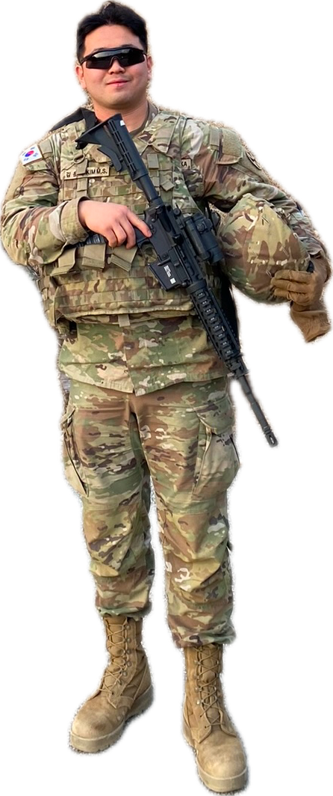
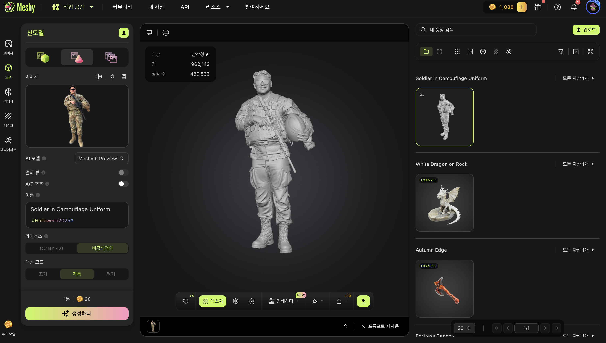
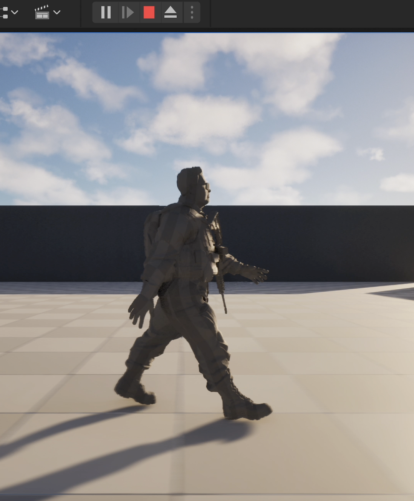
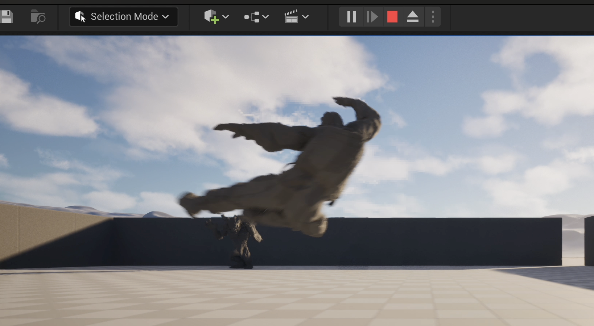
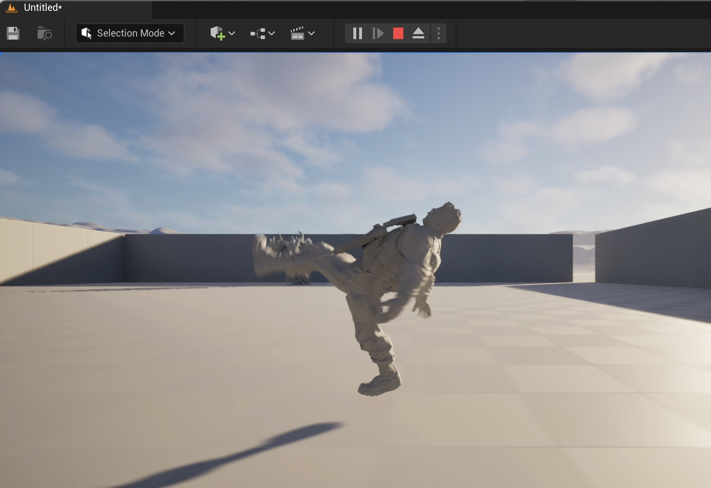
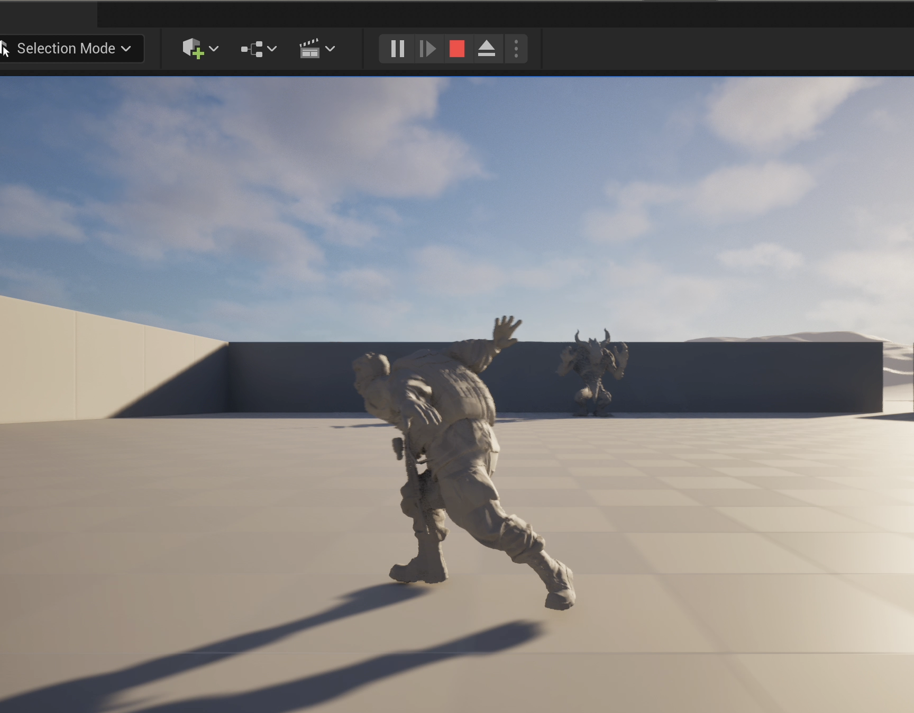
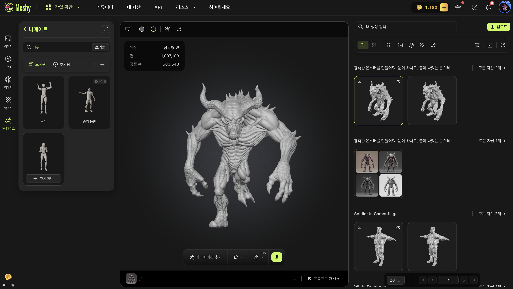
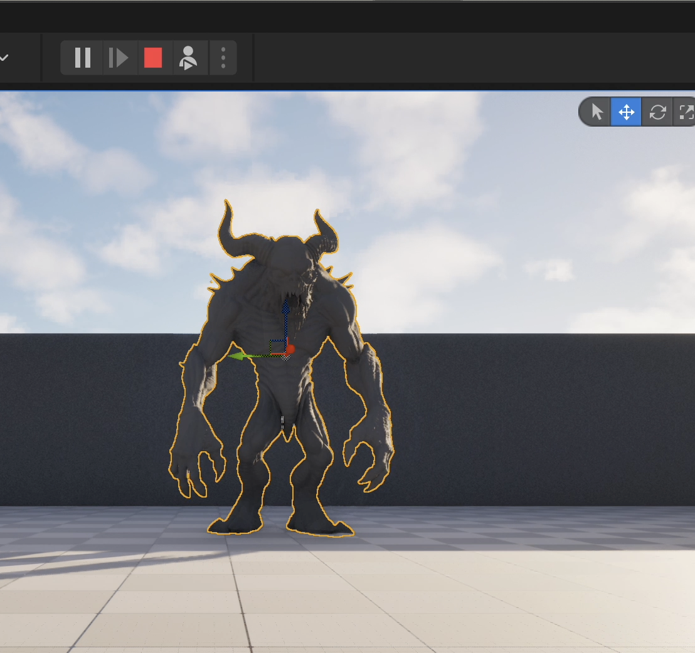
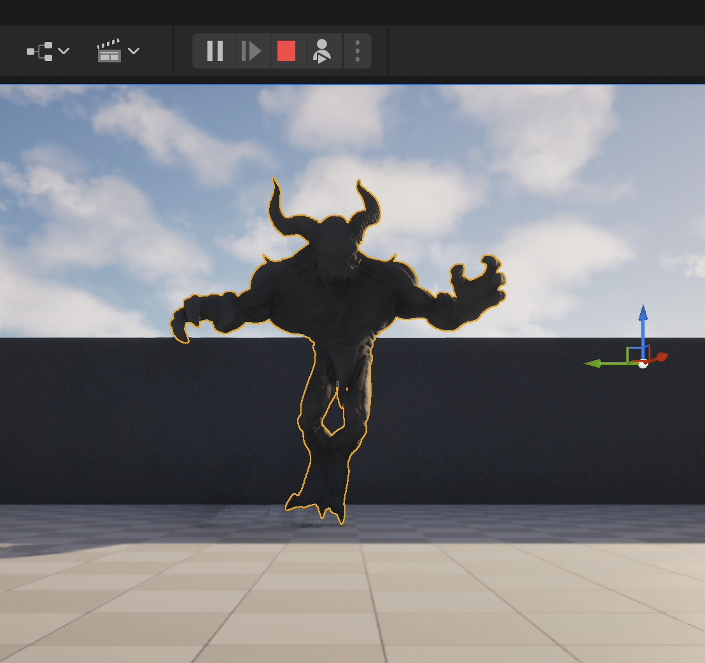
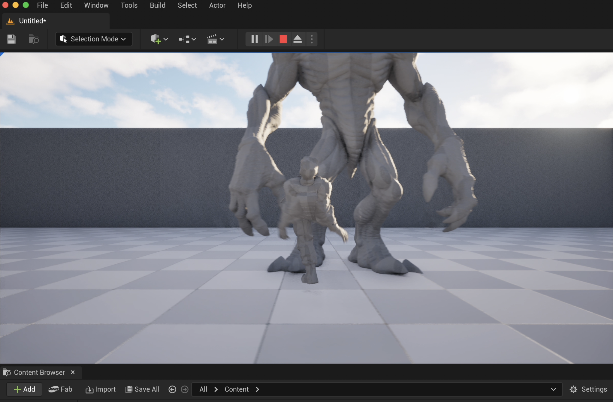

# AI-Powered Avatar Creation and Combat Game Prototype (Unreal Engine 5.5.4)

## Project Overview

This hobby project explores **AI-powered personal avatar creation and combat game development in Unreal Engine 5.5.4**.

Using **[Meshy.ai](https://www.meshy.ai/)**, I generated a 3D avatar from a real photo of myself and integrated it into Unreal Engine as a playable character with walking, running, and skill-based attack animations. I also created a separate monster model and attack animations to build a prototype combat encounter.

---

## Key Features

### AI Avatar Generation

- Generated an **AI-based 3D avatar model** from a real photo using Meshy.ai
- Created a mesh resembling the subject based on facial symmetry and contours
- Automatically generated textures, a bone structure, and a skeleton, then exported the model as an Unreal Engine-compatible FBX file

  
  &nbsp;&nbsp;&nbsp;&nbsp;
  

  <b>Left:</b> Original photo &nbsp;&nbsp;|&nbsp;&nbsp; <b>Right:</b> 3D avatar generated with Meshy.ai

---

### Avatar Animations

- Created walking, running, and Skill 1–4 animations for the AI-generated avatar
- Used the avatar's symmetrical structure to produce natural body movement
- Designed each skill animation around hand gestures and changes in posture

| Animation | Description | Preview |
|-----------|-------------|---------|
| Walk / Run | Basic movement animations |  |
| Skill 1 | Attack animation |  |
| Skill 2 | Attack animation |  |
| Skill 3 | Attack animation |  |

---

### Monster Model and Skill Animation

- Imported a prompt-generated FBX monster model into Unreal Engine

| Category | Description | Preview |
|----------|-------------|---------|
| Prompt | "Create a grotesque, one-eyed monster." | — |
| AI-generated result | 3D monster model generated with Meshy.ai |  |

| Category | Description | Preview |
|----------|-------------|---------|
| Monster model | The monster as it appears in the game |  |
| Monster skill animation | A scene from the monster's attack animation |  |

---

### Unreal Engine Integration and Combat Implementation

- Engine version: **Unreal Engine 5.5.4**
- Controlled the avatar through a character class derived from `ACharacter`
- Managed animations with an Anim Blueprint and a **state machine**
- Used a separate skeletal mesh for the monster and built a combat scene that responds to the player's skills
- Developed the project as a **single-player prototype** centered on one combat map

| Category | Description | Preview |
|----------|-------------|---------|
| In-game avatar | The personal avatar model in Unreal Engine |  |
| Walking animation | The character moving in the game |  |
| Character skill | An in-game combat scene showing the character using a skill |  |

---

## Future Improvements

- Add **Niagara particle effects** to skill animations
- Add **AI movement and combat logic** for the monster
- Implement real-time skill collision detection and integrate an HP system
- Build a character creation and appearance customization menu

---

## Developer

**Moonsu Kim**

- Sungkyunkwan University · Software Major
- Contact: kimmail99@naver.com

